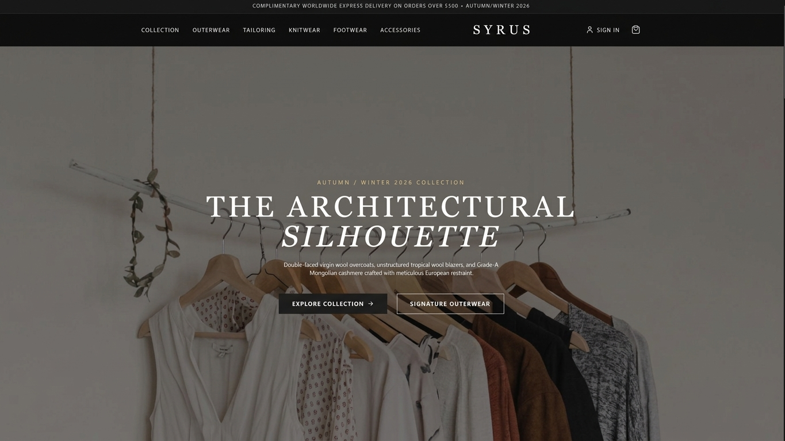

# SYRUS — Fashion E-Commerce

A full-stack fashion e-commerce web application built with Next.js, TypeScript, Tailwind CSS, and InsForge.

**[Live Website](https://syrus-fashion-commerce.vercel.app)** | **[GitHub Repository](https://github.com/Syrus-cell/Syrus-Fashion-Commerce)**

## About the Project

SYRUS is a personal web development project I started to improve my practical skills and gain experience in full-stack development.

I wanted to build a fashion shopping website with a clean design, simple navigation, and the essential features of an online store.

While working on SYRUS, I explored frontend development, backend integration, user authentication, and database services. I also gained practical experience with debugging, version control, and deploying a web application.

The project is still in development, and I'm continuing to improve it as I learn more.

## Features

- **Fashion Storefront:** A clean, modern interface for exploring clothing collections.
- **Product Browsing:** Category navigation and individual product detail pages.
- **User Authentication:** Google sign-in integrated with InsForge.
- **Shopping Cart:** Cart interface and state management.
- **Checkout and Orders:** Dedicated pages for checkout and order-related functionality.
- **Backend Integration:** InsForge for authentication and database services.
- **Deployment:** Hosted on Vercel with GitHub integration.

*Some features are still being developed and tested.*

## Technologies Used

| Technology | Purpose |
|---|---|
| Next.js | Application framework and routing |
| React | Frontend components |
| TypeScript | Application development |
| Tailwind CSS | Styling and responsive layouts |
| InsForge | Authentication and backend services |
| PostgreSQL | Database through InsForge |
| Git & GitHub | Version control |
| Vercel | Hosting and deployment |

## Screenshots

### Homepage

## What I Learned

Building SYRUS helped me understand how the different parts of a full-stack web application work together.

Some of the things I learned and practiced include:

- Structuring a project using Next.js and React.
- Building reusable components and responsive layouts.
- Working with TypeScript and Tailwind CSS.
- Integrating authentication with backend services.
- Connecting frontend functionality with InsForge.
- Managing environment variables.
- Using Git and GitHub for version control.
- Deploying a Next.js application on Vercel.
- Troubleshooting development and deployment issues.

I also used documentation, tutorials, and AI-assisted coding tools while developing the project. These helped me explore unfamiliar concepts, understand errors, and continue improving my development skills.

## Future Improvements

I plan to continue working on:

- Improving product search, filtering, and sorting.
- Completing and testing checkout and order management.
- Building an admin dashboard for managing products and orders.
- Adding wishlist functionality.
- Implementing real-time customer support chat.
- Improving inventory management.
- Strengthening security, accessibility, and performance.

## Project Status

**In Active Development**

SYRUS is deployed and accessible online. I'm continuing to develop and test its e-commerce functionality while improving the overall user experience.

## Developer

**Syrus-cell**

**GitHub:** https://github.com/Syrus-cell

**Live Website:** https://syrus-fashion-commerce.vercel.app

---

*SYRUS is a personal project developed as part of my learning and practical experience in full-stack web development.*

## Screenshots

### Homepage

